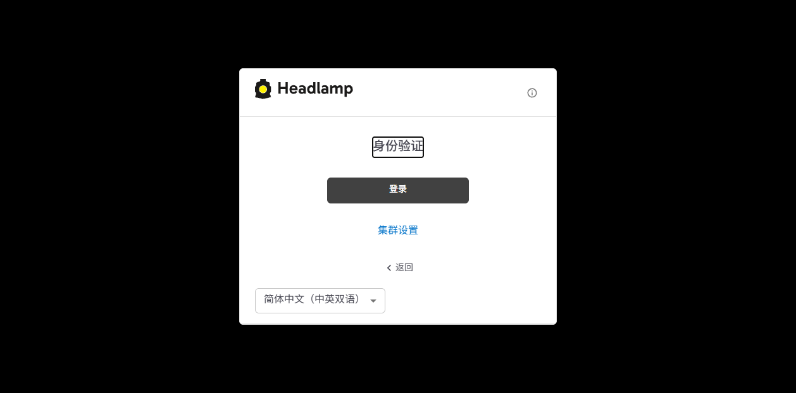

# BBT单点登录

Headlamp通过Rancher的OIDC登录，沿用BBT已有的Keycloak账号。登录后，Headlamp通过当前用户的`GET /v3/clusters`结果自动列出全部可访问集群，并把各集群的资源请求交给Rancher按该用户及其组权限鉴权。

兼容目标为[Rancher v2.15.3](https://github.com/rancher/rancher/releases/tag/v2.15.3)。Rancher提供的OIDC访问令牌可用于API认证，接口要求见[官方OIDC文档](https://ranchermanager.docs.rancher.com/how-to-guides/advanced-user-guides/configure-oidc-provider)。

## 注册Rancher OIDC应用

在升级后的Rancher启用`oidc-provider`功能。在 **Users & Authentication → OIDC Apps → Add Application** 中创建`Headlamp BBT`，使用以下配置。

| 字段 | 值 |
| --- | --- |
| Issuer | `https://rancher.bbt.sspu.edu.cn/oidc` |
| 本机回调 | `http://localhost:4466/oidc-callback` |
| 生产回调 | `https://headlamp.bbt.sspu.edu.cn/oidc-callback` |
| Scopes | `openid`、`profile`、`offline_access` |
| Access token有效期 | 3600秒 |
| Refresh token有效期 | 86400秒 |

使用Authorization Code流程并开启PKCE，方法为`S256`。应用生成的Client ID和Client Secret可同时用于本机和生产环境。

## 本机运行

将`.env.bbt-sso.example`复制为`.env.bbt-sso.local`，在`HEADLAMP_CONFIG_OIDC_CLIENT_ID`和`HEADLAMP_CONFIG_OIDC_CLIENT_SECRET`填入Rancher生成的值。本机文件已加入`.gitignore`和`.dockerignore`。如果本机尚未信任BBT根证书，将其PEM文件的绝对路径填入`HEADLAMP_CONFIG_OIDC_CA_FILE`。

```powershell
npm --prefix frontend ci
npm run bbt:plugins:install
npm run build
npm run start:bbt-sso
```

系统环境变量优先于本机文件。`HEADLAMP_CONFIG_RANCHER_URL`配置Rancher地址，集群地址随当前用户的集群列表自动生成。服务只监听`127.0.0.1:4466`。

在浏览器打开`http://localhost:4466/`，从`bbt-sso`入口点击 **登录**。登录后返回集群列表，显示Rancher中的集群原名。



使用同一账号分别在Headlamp和Rancher检查：

- 全部可见集群，以及各集群的命名空间、工作负载和资源操作权限。
- 普通账号访问未授权命名空间和集群时，返回权限错误。
- 两个账号的集群列表、连接和端口转发记录分别保存。
- 访问令牌到期后自动刷新；退出Headlamp后，该登录会话在全部集群失效。

浏览器仅保存HttpOnly随机会话Cookie。访问令牌和刷新令牌保存在服务端内存中，由OAuth2客户端刷新。Headlamp退出操作结束当前Headlamp会话；Rancher本身的登录状态由Rancher管理。

## 生产部署

生产使用同一OIDC应用和同名环境变量。首次发布前，将Client ID和Client Secret存入`headlamp`命名空间的`headlamp-bbt-sso` Secret，键名分别为`client-id`和`client-secret`。同一命名空间的`headlamp-rancher-ca` ConfigMap以`ca.pem`保存签发Rancher服务器证书的CA。发布工作流加载`deploy/web/sso-values.yaml`，设置生产回调地址、Rancher证书校验及24小时会话有效期。

部署使用单副本；进程重启后用户重新登录。Pod不挂载ServiceAccount令牌，各集群访问均使用当前登录用户的身份。

## 验证命令

```powershell
npm run backend:build
Set-Location backend
go test ./cmd ./pkg/auth ./pkg/kubeconfig ./pkg/rancher
go test ./pkg/config
```

`backend/pkg/rancher/client_live_test.go`通过已有个人kubeconfig执行真实只读API检查，须显式设置`HEADLAMP_RANCHER_TEST_KUBECONFIG`和`HEADLAMP_RANCHER_TEST_CONTEXT`。执行时按BBT Ops规范记录脱敏操作日志。该检查验证API集群发现和匿名访问边界；完整SSO验证使用升级后的Rancher、注册的OIDC应用和真实用户登录。
